# Osoem 
### _Engineering Project Management Simplified_

## Table of Contents

- [Introduction](#introduction)
- [License](#lincense)
- [Setup](#setup)
- [Osoem Database](#osoem-database)
- [Osoem Dashboard](#osoem-dashboard)
- [Osoem Admin](#osoem-admin)
- [Osoem Agents](#osoem-agents)

## Introduction

Osoem is a database system designed for managing engineering projects. Engineering projects can be complex and generate lots of data, this makes managing them a challenge. Having separate systems to collect all the data is inefficient as important relationships between the data can often go unnoticed. However, having a unified system is also challenging due to the big variety in the types of engineering projects and disparate types of data that needs to be tracked. 

The Osoem database solves this by defining an abstraction called the "Artefact" which can represent any data in a project that needs to be tracked. By assigning milestones to these artefacts and associating them with activities in the project, progress of the artefact can be seamlessly monitored as the project progresses.

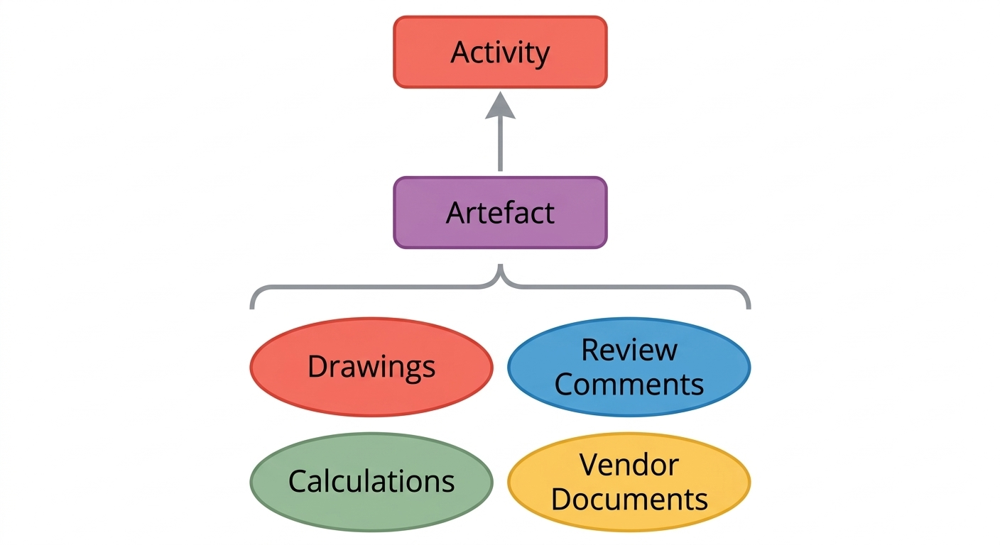

The key idea here is that an artefact and its progress milestones are completely customizable. This gives the user the ability to define their own type of artefact based on the need of the project. An example of an artefact in an engineering project could be a drawing. Details such as the title, drawing number, issued date, preparer, reviewer, etc. can define the data that the artefact stores. To measure progress the user can create milestones for different stages of the drawing preparation such as review and approval. Artefacts need not only be engineering deliverables; they can represent review comments, non-conformances, commodities, etc. It is this flexibility that makes Osoem different from other available data management systems for engineering project management.

Activities in a project are organized into a work breakdown structure by sorting them into categories and sub-categories. Each activity can also be broken-up in to a hierarchy of tasks and sub-tasks.

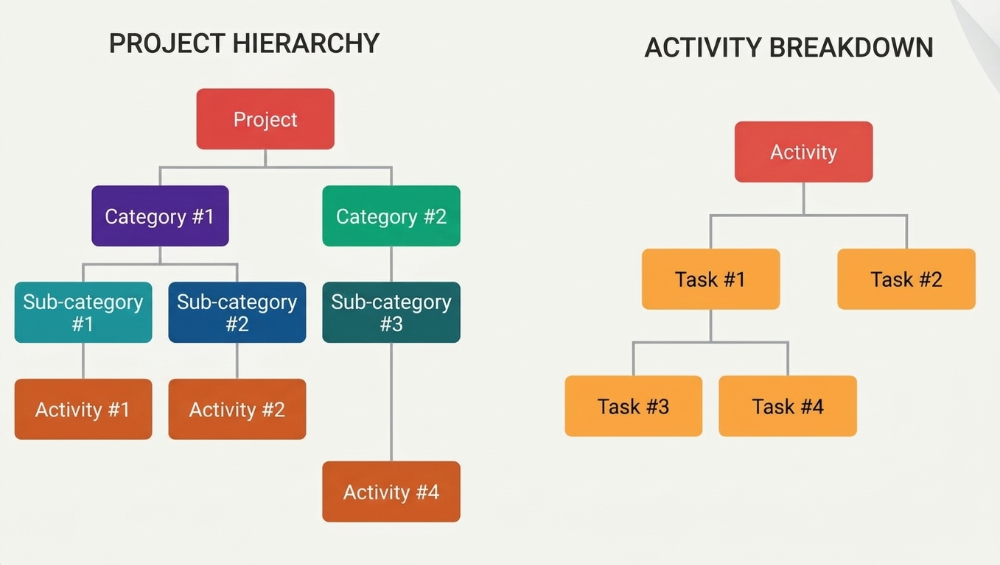
 
No project can be sucessfully completed without the people involved. The database defines a tier based access rights to all users.

There are special user access rigths confered on certain users. These are:

**Admin** The admin has rights to run commands in the Admin tool that modify the database. This tool gives the most access to play with data, that gives it the most potential to cause damage, so it is best to limit this level of access to a few people. The admin, for example has the ability to add/delete projects or to change the password on any account.

**Activity Manager** An activity manager has all the rights to a given activity. They can create tasks, assign tasks, and link artefacts to activities.

**Artefact Owner** An artefact owner has all the rights to a given artefact. The can edit the data, and link activities to an artefact.

Within the project team there are three levels of access:

**Member** The member has the lowest level of access in the project. They can complete tasks assigned to them. Mark milestone steps as complete, and book time on the activity. They have the ability to view all the progress of the activities and artefacts in the project.

**Lead** A lead has all the rights of an Activity Manager and an Artefact Owner in a project. They can also delegate activities and Artefacts in a project.

**Manager** This is the project manager (not to be confused with the activity manager) who has the maximum access level in the project. They have all the rigths of a lead, plus the ability to add activities, artefacts, milestones etc.

## Setup

A detailed description of how to setup the various components of this project are given in the following locations:
- Osoem Database [`database/README.md`](database/README.md)
- Osoem Dashboard [`dashboard/README.md`](dashboard/README.md)
- Osoem Admin [`admin/README.md`](admin/README.md)
- Osoem Agents [`agents/README.md`](agents/README.md)

## License

This project is licensed under the [GNU GPLv3](./LICENSE.txt) license.  

## Osoem Database

The complete SQL schema for the database is at [`database/schema/schema.sql`](database/schema/schema.sql). The database for this project is based on my blog article [A Database Schema for Engineering Project Management](https://medium.com/@roshnnoronha/a-database-schema-for-engineering-project-management-51d1b1f1078c).

## Osoem Dashboard

The Osoem Dashboard is the front-end for the Osoem database. It is used by the project team in their day-to-day work, like checking the progress of activities, managing tasks, booking hours, updating artefacts etc. It is meant to link together the different parts of the database and present it in a visually appealing user interface. The user logs in to the system using their email and password, and is the user interface that is presented depends on the access rights of the user.

The Osoem Dashboard comprised of the following pages:

**Dashboard.php**

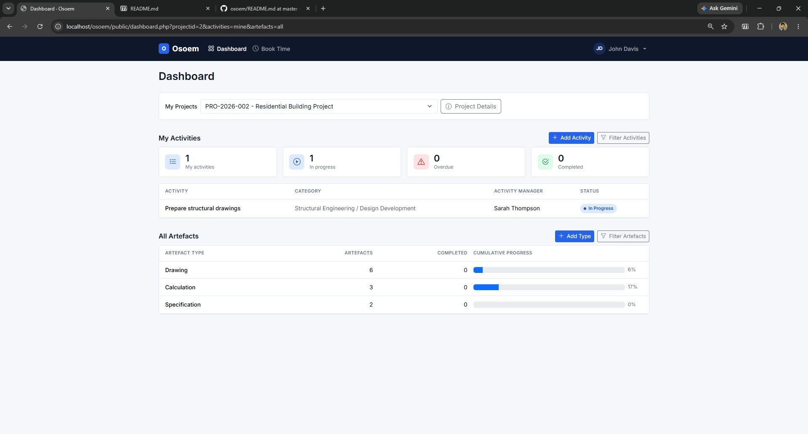

This is the landing page which summarizes the status of the activities and artefacts in a given project. The available options on this page are:

| Option | Description | Access Rights |
| --- | --- | --- |  
| | Used to view project details. Opens the project.php page | Everyone | 
| | Used to filter the activities shown in the dashboard. | Everyone |
| | Used to create a new activity in the project. | Manager |
| | Used to filter the artefacts shown in the dashboard | Everyone |
| | Used to create a new artefact type. | Manager |

**Project.php**

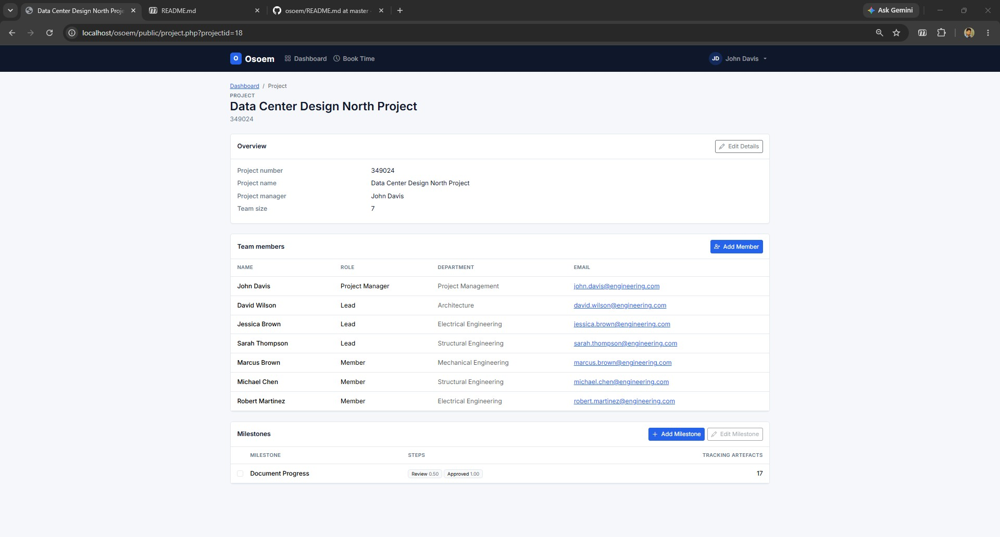

Displays the details of the project, the team members and the associated milestones.

| Option | Description | Access Rights |
| --- | --- | --- |  
|  | Used to edit the details of the project. | Manager
|  | Used to add a new member to a team. (Note: Once a member is added to a team they cannot be removed.) | Manager 
|  | Used to add an new milestone to the project. (Note: Once a milestone is added to a project it cannot be removed.) | Manager
|  | Used to update the details of an existing milestone. | Manager 

**Activity.php**

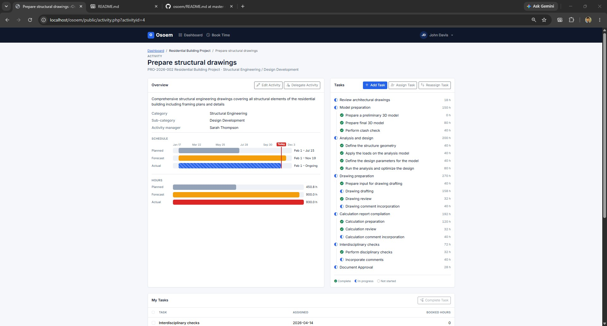

The main working page for an activity. Shows an overview, a Gantt chart of planned, forecast and actual dates, a bar chart of planned, forecast and actual hours, the task tree, the user's open tasks, the linked artefacts and the activity notes.

| Option | Description | Access Rights |
| --- | --- | --- |  
|  | Used to edit the details of an activity. | Activity manager, Lead, Manager 
|  | Used to nominate the activity manager. | Lead, Manager 
|  | Used to add a new task or sub-task to the activity. | Activity manager, Lead, Manager 
|  | Used to assign a task or sub-task to a user. | Activity manager, Lead, Manager 
|  | Used to reassign an assigned task or sub-task to another user. | Activity manager, Lead, Manager 
|  | Used to close a given task. | Activity manager 
|  |Used to mark a task as complete. Once a task is marked as complete it is assigned to the activity manager who can mark it as closed. | Everyone except the activity manager
|  | Used to link an existing artefact to the current activity. | Activity manager, Lead, Manager  
|  | Used to associate a milestone with the selected artefact. | Activity manager, Lead, Manager  
|  | Used to remove a linked artefact. This option does not delete the artefact, just removes the association with the activity. | Activity manager, Lead, Manager  
|  | Used to mark milestone steps complete for a given artefact. (Note: Only a Lead or Manager can untick a completed step.) | Everyone
|  | Used to add a note to the activity. | Everyone

**Tasks.php** 

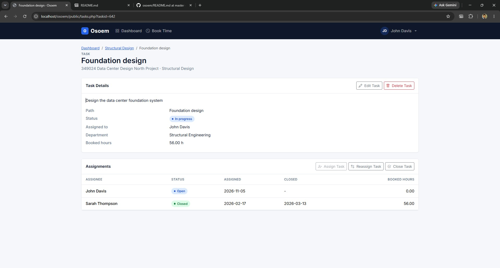

Shows the task details, the assignment history of the task and its sub-tasks.

| Option | Description | Access Rights |
| --- | --- | --- |  
|  | Used to edit task details. | Activity manager, Lead, Manager
|  | Used to delete a task. | Activity manager, Lead, Manager
|  | Used to assign a task. | Activity manager, Lead, Manager
|  | Used to reassign a task. | Activity manager, Lead, Manager
|  | Used to close an open task. | Activity manager
|  | Used to complete a task and handover the task to the activity manager. | Everyone except the activity manager

**Artefacts.php**

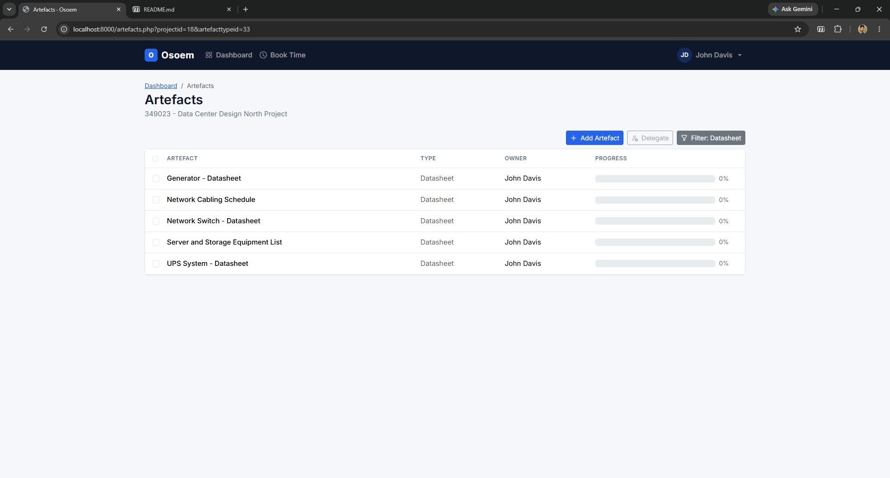

Shows all artefacts in a project, filterable by artefact type.

| Option | Description | Access Rights |
| --- | --- | --- |  
|  | Used to add a new artefact. | Manager
|  | Used to nominate an artefact owner. | Lead, Manager 
| ,  | Used to filter the displayed artefacts by type. Displays any active filters in the option name. | Everyone 

**Artefact.php**

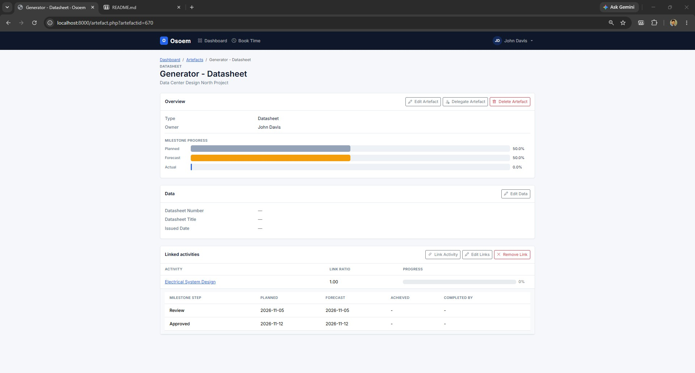

An artefact's details and its progress in each activity it is linked to.

| Option | Description | Access Rights |
| --- | --- | --- |  
|  | Used to edit the details of the artefact. | Artefact owner, Lead, Manager 
|  | Used to change the owner of the artefact. | Lead, Manager 
|  | Used to delete an existing artefact. | Manager 
|  | Used to edit the data fields of an artefact. | Artefact owner, Lead, Manager 
|  | Used to link another activity to the artefact. | Artefact owner, Lead, Manager 
|  | Used to edit the linked activity ratios. | Artefact owner, Lead, Manager 
|  | Used to remove the link of an activity to the artefact. | Artefact owner, Lead, Manager 

**Artefact Data**

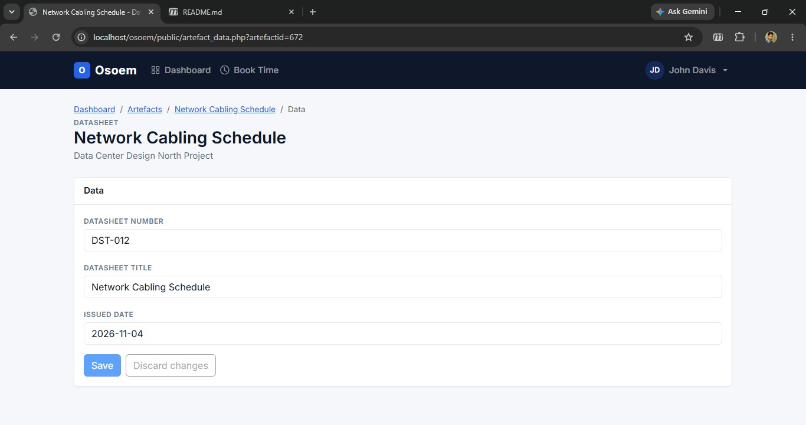

View and edit the data fields of an artefact.

| Option | Description | Access Rights |
| --- | --- | --- |  
|  | Saves any changes made to the artefact data. | Artefact owner, Lead, Manager  
|  | Discards any changes made to the artefact data. | Artefact owner, Lead, Manager 

**Book Time**

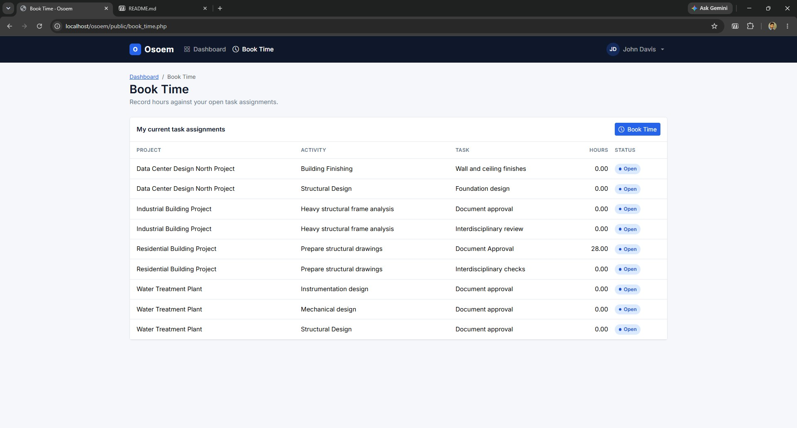

Book hours against any of the user's current task assignments.

| Option | Description | Access Rights |
| --- | --- | --- |  
|  | Used to book time in an assigned task. | Everyone | 


## Osoem Admin

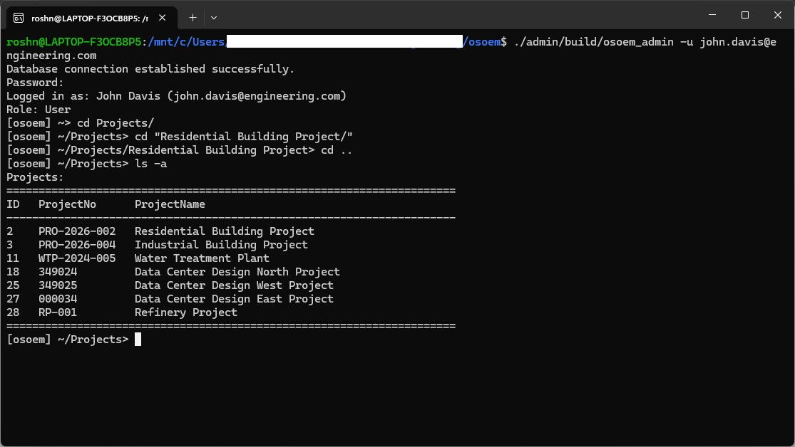

The Admin tool is a command-line administrative tool for managing the Osoem database. It provides an interactive shell with a hierarchical folder-like interface for navigating and manipulating project data. The tool can be run in either the interactive mode or batch mode. In the interactive mode the user inputs a single command at a time. In batch mode a set of commands from a source file are executed together. The basic syntax for running the admin tool is as follows:

```bash
./osoem_admin -u <user_email> [<source_file>]
```

The <source_file> parameter is optional and provides the path to a source file; when it is provided the program runs in batch mode executing the commands listed in the file line by line. If the source file parameter is not provided the program enters the interactive mode.
 
The `-u` flag is used to provide the user email. This is a required parameter and is used to authenticate the user against the database. To verify the user, the tool prompts for a password before granting access. Authenticated users are assigned a role (Admin or User). Non-admin users have read-only access and cannot use data modification commands.

### Interactive Mode 


In the interactive mode the tool lets the user explore and modify the data in the Osoem database. To enable this the program organizes data in a navigable folder-like hierarchy which the user can navigate using commands akin to browsing folders in a terminal. Commands such as `cd` and `ls` make this navigation familiar and intuitive. Features such as context-aware tab completion for commands and item names simplify the user experience.

To enter interactive mode use the following syntax to invoke the program:

```bash
./osoem_admin -u user@example.com 
```

The data is organized into the following hierarchy with the root represented by `~`.

```
 ~ 
 ├── `Organization` Folder
 │   └── `Departments` Folder
 │       └── <Departments>
 │           └── <Employees>
 └── `Projects` Folder
     └── <Projects>
         ├── `Activity Categories` Folder
         │   └── <Activity Categories>
         │       └── <Activity Subcategories>
         │           └── <Activities>
         │               ├── `Tasks` Folder
         │               │   └── <Tasks>
         │               │       ├── `Tasks` Folder
         │               │       │   └── <Tasks>
         │               │       │       ├── `Tasks` Folder
         │               │       │       │   └── <Tasks>
         │               │       │       │       : 
         │               │       │       └── `Assignments` Folder
         │               │       │           └── <Assignments>
         │               │       │               └── <Hours>
         │               │       └── `Assignments` Folder
         │               │           └── <Assignments>
         │               │               └── <Hours>
         │               └── `Notes` Folder
         │                   └── <Notes>
         ├── `Artefact Types` Folder
         │   └── <Artefact Types>
         │       ├── `Artefacts` Folder
         │       │   └── <Artefacts>
         │       │       ├── `Data` Folder
         │       │       │   └── <Artefact Data>
         │       │       └── `Associations` Folder
         │       │           └── <Activities Associated>
         │       │               └── <Milestones Associated>
         │       └── `Fields` Folder
         │           └── <Artefact Fields>
         ├── `Milestones` Folder
         │   └── <Milestones>
         │       └── <Milestone Steps>
         └── `Team` Folder
             └── <Team Members>
```
The program prompt displays the current location of the user in the hierarchy.

There are a number of commands that can be used to navigate and modify the data in the database. Most commands have required parameters which can be an item name or the numeric IDs. Name matching is case-insensitive. If multiple matches are found, the first match is used with a warning. In addition to items, commands can take characters that have special significance as parameters. Two such parameters are `~` that signifies the root, and `..` that signifies the location one step above in the hierarchy.  Some commands can also take optional flags that modify the behaviour of the command.

A list of the commands available in the program is given below:

**`list` or `ls`**

```
list [-a]
```

Lists items at the current location. By default the command displays just the names and IDs of the items in the current location of the hierarchy. This command also takes an optional flag `-a` that shows all the fields of the data in a tabular format. 

```
list        # Show ID and name
ls -a       # Show all fields in tabular format
```

**`select`, `sl`, or `cd`**

```
select <id|name|path>
```

Navigates to an item or folder. It takes as parameter either the name or ID of the item to navigate to. It is also possible to navigate multiple levels of the hierarchy using a single command by providing the full path to navigate to where each level is separated by a `/`. 

```
select "Projects/Residential Building Project/Activity Categories/Architecture/"        # Navigate to `Architecture` activity category from root
sl "Building Project"                                                                   # Navigate to item `Building Project` by name
cd 1                                                                                    # Navigate to an item `1` by ID
cd ..                                                                                   # Go up one level in the hierarchy
cd ~                                                                                    # Return to root
```

NOTE: For employees, selection works with either the full name, first name, or last name as parameter.

**`add` or `ad`**

```
add ["<field>:<value>,<field>:<value>..."]
```

Adds a new item at the current location. When no parameter is provided the user is prompted to enter the values for fields one by one. Optionally, the command takes a string parameter which is expected to contain a comma separated list of <field>:<value> pairs.  

```
add                                             # Prompts for fields
ad "taskname:Review,departmentname:Structure"   # Uses a string parameter with comma separated <field>:<value> pairs
```

The expected field names depend on the current location in the hierarchy:

| Location | Fields |
|---|---|
| Departments | `departmentname` |
| Employees | `firstname, lastname, email, password, admin` (admin: 0 or 1) |
| Projects | `projectname, projectno` |
| Team | `employeeid`/`employeename`, `role` (role: 0=Member, 1=Lead, 2=Manager) |
| Activity Categories | `categoryname` |
| Subcategories | `subcategoryname` |
| Activities | `activityname`, `activitymanagerid`/`activitymanagername`, `activitydescription, plannedstart, plannedfinish, plannedhours` |
| Tasks / Sub-tasks | `taskname, taskdescription`, `departmentid`/`departmentname` |
| Assignments | `userid`/`username`, `assigneddate, closedate` |
| Hours | `hours, bookeddate` |
| Notes | `userid`/`username`, `note, notedate` |
| Artefact Types | `artefactname, artefactdescription` |
| Artefacts | `artefacttitle`, `artefactownerid`/`artefactownername` |
| Fields | `fieldtitle, valuetype, maximumlength, maximumvalue, minimumvalue` |
| Artefact Data | `artefactdatafieldid`/`fieldname`, `value` |
| Associations (Artefact-Activity Links) | `activityid`/`activityname`, `ratio`, `categoryname, subcategoryname` (optional, to pick between activities with the same name) |
| A selected Association (adds a Milestone-Artefact Link) | `milestonestepid`/`milestonestepname`, `completedbyid`/`completedbyname`, `completiondate` |
| Milestones | `milestonename` |
| Milestone Steps | `milestonestepname, progressratio` |

Where two fields are shown as `<field>id`/`<field>name`, either the ID or the name of the item can be given.

Validation is performed on the value before modifying the database. Some of the validation checks performed are listed below.

Name fields (`departmentname`, `projectname`, `categoryname`, `subcategoryname`, `activityname`, `taskname`, `milestonename`, `milestonestepname`, `artefactname`, `artefacttitle`, `fieldtitle`, and employee `firstname`/`lastname`):
- Cannot be empty
- Cannot contain reserved characters: `,  :  /  ~`
- Cannot start with a number or a `.`
- Must not exceed 255 characters

Date fields (`plannedstart`, `plannedfinish`, `assigneddate`, `closedate`, `bookeddate`, etc.):
- Must be in `YYYY-MM-DD` format
- Start date must not be after end date
- Assignment `closedate` must not be before `assigneddate`
- Assignment `assigneddate` cannot be after the activity's actual finish date

Numeric fields:
- `hours`: must be a positive integer
- `ratio` (artefact-activity link): must be between 0.0 and 1.0
- `progressratio` (milestone steps): must be between 0 and 1
- `valuetype` (artefact data field): must be `0` (text) or `1` (numeric)
- Team member `role`: must be `0` (Member), `1` (Lead), or `2` (Manager)
- `maximumlength` (text fields): must be positive and not exceed 2000
- `minimumvalue` must not exceed `maximumvalue` (numeric fields)

Special fields:
- `projectno`: cannot be empty or contain `,` or `:`; max 255 characters (may start with a number)
- Employee `email`: cannot be empty, must contain `@`, max 255 characters
- Employee `password`: cannot be empty, max 255 characters
- `activitydescription`/`artefactdescription` cannot be empty or start with a number; cannot contain `,` or `:`; max 1000 characters
- Notes: cannot be empty; max 2000 characters
- `taskdescription`: max 2000 characters
- Artefact data `value`: max 2000 characters

Relationship constraints:
- Activity manager must be a member of the project team
- Artefact owner must be a member of the project team
- Assignment employee must be a member of the project team

NOTE: As this command modifies the data, running it requires admin privileges.

**`remove` or `rm`**

```
remove <id|name>
```

Removes an item by ID or name.

```
remove 5                # Remove by ID
rm "Project Alpha"      # Remove by name
```

NOTE: As this command modifies the data, running it requires admin privileges.

**`set` or `st`**

```
set <id|name> "<field>:<value>, <field>:<value>, ..."
```

Updates one or more fields on an item at the current location. The first argument identifies the item by ID or name; the second argument is a comma separated list of <field>:<value> pairs similar to the `add` command. Field names aren't case-sensitive. Arguments are separated by spaces, so put an argument in quotes whenever it contains a space: an item name such as `"Task 1"`, or a field list such as `"plannedstart:2026-06-01, plannedfinish:2026-07-01"`.

```
set 5 "activityname:New Name"
st "Design Review" "plannedstart:2026-06-01, plannedfinish:2026-07-01"
```

The `set` command performs the same validation of the values as the `add` command before modifying the database.

NOTE: As this command modifies the data, running it requires admin privileges.

**`import` or `im`**

```
import [-i|-r] <filename>
```

Imports data from a CSV file into the database. The CSV file must have a header row with column names matching the expected fields for the current location. The filename can be the path to the CSV file.

The `import` command takes two optional flags:
- The `-r` (recursive) flag is used to import several levels of data from a single CSV file, such as an activity with its tasks, assignments and hours. A recursive import carries out the following steps:
  1. It checks whether a matching record already exists in the current scope. For example, it looks for a department with the same departmentname, or a subcategory with the same name in the same category.
  2. If there's no match, it creates the record.
  3. If there is a match, it reuses that record's ID and overwrites its fields with any non-empty values from the CSV.
  4. It then carries on importing the levels below that record, under the existing ID.
- The `-i` (ignore duplicates) flag skips rows with duplicate records, instead of stopping with an error.

NOTE: Only one of the two flags can be used at a time with this command.

```
import "../employees.csv"               # Normal import — error on duplicate entries
im -i employees.csv                     # Ignore duplicates 
im -r "/path/to/file/activities.csv"    # Recursive import 
```

The `import` command performs the same validation of the values as the `add` command before modifying the database.

NOTE: As this command modifies the data, running it requires admin privileges.

**`export` or `ex`**

```
export <filename>
```

Exports data at the current location to a CSV file. The name of the output file is provided as a parameter.

```
ex output.csv
```

WARNING: This command overwrites existing files without asking. 

**`exit` or `quit`**

```
exit
```

Exits the interactive shell. 

**`help` or `h`**

```
help [<command>]
```

Displays syntax and help text for a given command.

```
help ls
h cd
```

### Batch Mode

In batch mode, commands are read from a text source file and executed sequentially. Batch mode runs with admin privileges. To use the program in batch mode use the following pattern to invoke the program from the terminal.

```bash
./osoem_admin -u user@example.com ./setup_project.src
```

An example source file is shown below:

```
# setup_project.src
# Lines starting with # are comments; blank lines are skipped

cd ~
cd Projects
cd "Refinery Project"
cd "Team"
add "employeeid:2,role:2"
cd ..
cd "Activity Categories"
cd Engineering
cd Structural
ad "activityname:Foundation Design,activitymanagerid:2,plannedstart:2026-01-01,plannedfinish:2026-06-01,plannedhours:500"
st "Foundation Design" "plannedhours:600"
im -r "./data/activities.csv"
ex "./out/activities.csv"
```

There are certain rules to follow when creating a source file:
- Lines starting with `#` are treated as comments and skipped. Only a `#` in the very first column counts. A line that starts with spaces and then `#` is run as a command and will lead to an error.
- All the commands - `cd`/`sl`, `ls`, `ad`, `rm`, `st`, `im`, `ex` - work the same as in interactive mode. Each line runs from wherever the previous `cd` left the program, so start with `cd ~` to start from a known position.
- Relative file paths in `im` and `ex` are resolved from the source file's directory, not from where the tool is invoked.
- The first data error stops the run and skips every line after it. This can lead to partially imported data, so trying to source the same source file again would lead to duplicate entry errors. One solution to this is to remove all the commands that modify the database, such as `add` and `set`, from the source file up to the line that caused the error before trying again.
- The `add` command with no parameter field string is not allowed in a source file.
- The `remove` command skips its confirmation prompt during batch execution.
- The program exits after the batch run.

There are full working scripts in ./admin/examples/. 

## Osoem Agents

The Osoem Agents are a collection of AI agents that read and update the data in the Osoem database. Each agent is a C++ command-line program that holds a conversation with the user and uses OpenAI tool calling to work with the database. Each agent exposes a fixed set of tools, such as "list the activities in a project" or "create a task", that run checked queries against the database on the model's behalf.

All agents follow the same basic pattern:
1. On startup the user selects a working scope, which is a project for the planner and an activity for the reviewer. Tab completion is available for names.
2. The user then chats with the agent at the `>` prompt. The agent calls its tools as needed to answer questions or make changes.
3. All writes are limited to the working scope, and the agent asks for confirmation before changing any data.
4. Typing `clear` resets the conversation, and `exit` or `quit` ends the session.

### Osoem Planner Agent

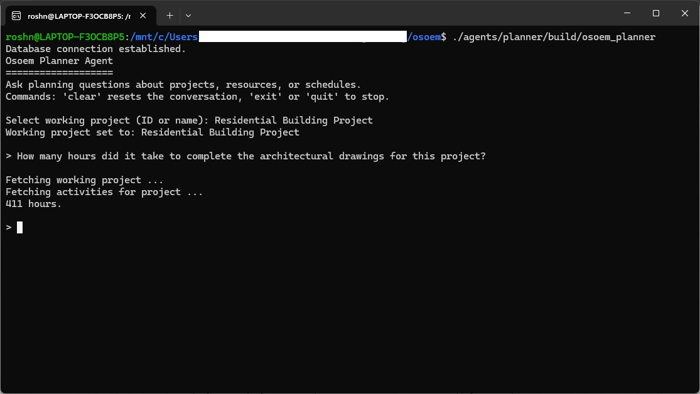

The planner agent helps plan new projects using the data from past projects. Data from past projects such as the hours booked, task breakdowns and staffing are a good guide to planning the next one. The planner searches this history for comparable activities and uses it to propose activity structures, effort estimates and team members for the working project.

```bash
./osoem_planner
```

The planner has the following tools:

| Type | Tools |
|---|---|
| Read | List projects, employees and departments; list the activities in a project with planned and actual hours; list the tasks in an activity; summarise the hours an employee has booked on a project or task; list an employee's task assignments |
| Create | Activity categories, subcategories, activities, tasks; add team members |
| Update | Activity description, manager, planned and forecast start/finish/hours; task description and department |

Data written by the planner follows the same validation rules as the admin tool, such as no reserved characters in names.

### Osoem Reviewer Agent [WIP]

The reviewer agent checks engineering documents against a set of specifications and records each non-compliance it finds as a comment in the database. The documents to be reviewed are artefacts linked to the working activity. A document artefact has a `path` data field that gives the location of the file, which lets the agent open and read it.

```bash
./osoem_reviewer
```

The specifications are Markdown files kept in the `specs/` folder. At startup the reviewer splits each specification into sections and builds a search index using OpenAI embeddings. This lets the agent find the clauses relevant to a document without loading every specification in full. PDF specifications can be converted to Markdown with `specs/convert_pdfs.py`.

The reviewer has the following tools:

| Type | Tools |
|---|---|
| Read | Show the working activity; list the artefacts linked to it; read a document artefact's file; list the specifications; search the specifications by topic; read a full specification |
| Create | Add a review comment |

A review comment is stored as a `Review Comment` artefact linked to the working activity. Each comment records a title, the location in the document (e.g. `Section 3.2, Table 1`), the issue, the specification clause it refers to and a severity of `Minor`, `Major` or `Critical`. If the project does not yet have a `Review Comment` artefact type, the reviewer creates it along with its fields. Because the comments are ordinary artefacts, they can be viewed, tracked against milestones and exported with the admin tool like any other artefact.

